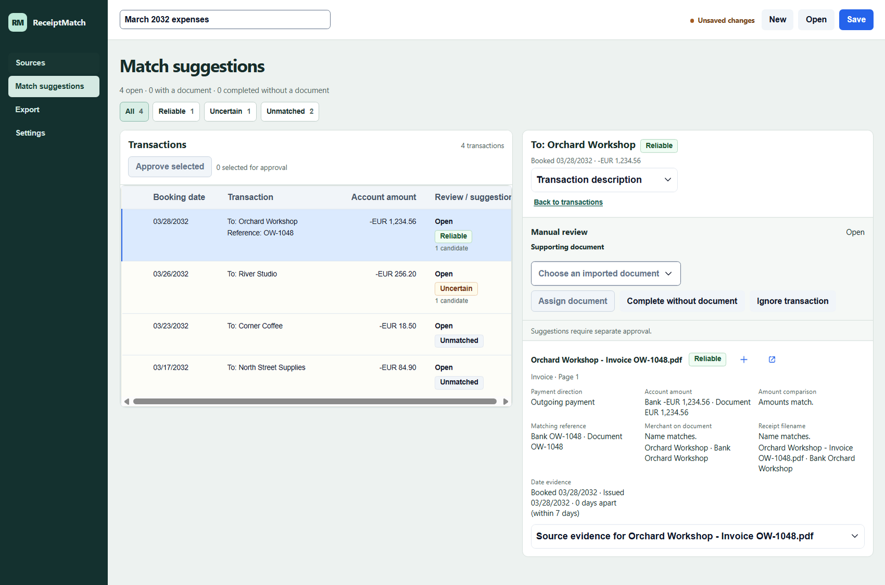

  

<h1 align="center">ReceiptMatch</h1>

<strong>Match receipts to payments. Know what’s still missing.</strong>

  <a href="https://github.com/Wigtertainment/receiptmatch/releases"><strong>Download the latest release</strong></a>
  · <a href="#what-receiptmatch-can-do">Features</a>
  · <a href="#read-scans-and-photos-with-local-ai">Local AI</a>

Closing the books is easier when every payment has a document. Give ReceiptMatch a bank statement and the folder where you keep your receipts and invoices. It suggests which documents belong to which payments and shows you where a receipt is still missing.

ReceiptMatch is a free, open-source desktop app for freelancers and small businesses. It processes your financial files on your computer and keeps your original documents in place.

*The Orchard Workshop invoice matches the payment amount and reference. Two other payments are still missing a document. This example uses fictional data.*

## What ReceiptMatch can do

- **Read receipts, invoices, and scans.** Pull details such as merchant names, dates, totals, and invoice numbers from your documents. Use optional local AI to read scans and photos.
- **See why a match was suggested.** Compare amounts, dates, and references side by side, and open the original document from the review.
- **Keep track of missing receipts.** See which payments still need a document. Approve a suggestion, choose a different document, or leave a payment open for follow-up.
- **Hand over reviewed records.** Export copies of approved documents with an optional CSV report for your bookkeeper.

## Read scans and photos with local AI

A phone photo of a receipt or a scanned invoice often has no text you can search or copy. ReceiptMatch can read the image on your computer and use the recognized text to find details such as the total or invoice number. Those details can help ReceiptMatch suggest a matching bank transaction for you to review.

Open **Settings → Document recognition** to choose how ReceiptMatch reads scans and photos.

| Option | When to use it |
| --- | --- |
| **Standard OCR** | Built-in text recognition you can use right away. |
| **PP-OCRv6 Medium** | A smaller AI model for everyday scans and receipt photos. |
| **PaddleOCR-VL 1.6** | A larger, slower AI model you can try on difficult scans, photos, and complex layouts. |

Download and select an AI model in Settings. Recognition then runs on your computer without uploading your documents. ReceiptMatch reads embedded text directly when it’s available in a PDF.

## How it works

1. **Add your statement and receipts.** Create a workspace and open **Sources**. Use **Import statement** for your bank PDF and **Choose folder** for receipts and invoices.
2. **Check the suggested matches.** In **Match suggestions**, see what supports each suggestion, such as a shared amount, date, or payment reference. Open the original to check a detail, assign a different document, or leave the payment open for follow-up.
3. **Send checked records to your bookkeeper.** Select the matches you've checked, click **Approve selected**, then **Save**. In **Export**, choose **Export copies only** or **Export CSV and copies** to include a report with transaction and review details.

## What you can import

| Source | Supported inputs |
| --- | --- |
| Bank statements | English **Revolut Business EUR** and **Airwallex EUR Account Activity** PDFs. For other PDF layouts, try the optional local AI import. |
| Receipts and invoices | **PDF**, **PNG**, and **JPEG** files in a folder and its subfolders |

To try the local AI import, install **PaddleOCR-VL 1.6** under **Settings → Document recognition**. If the built-in import cannot read the layout, choose **Try with local AI**. Review the proposed transactions and their source text before confirming the import. Layouts with unrecognized columns or an unclear account currency may need review or may be unreadable.

## Download

Get the latest version from [GitHub Releases](https://github.com/Wigtertainment/receiptmatch/releases). Choose the **Windows x64 installer** or the **Ubuntu x64 `.deb` or AppImage** under **Assets**.

After opening ReceiptMatch, select **Create workspace**. Save it as a `.receiptmatch` file to keep your review and pick up where you left off.

## Support

[Report a problem or request a bank format](https://github.com/Wigtertainment/receiptmatch/issues) · [MIT license](LICENSE)
