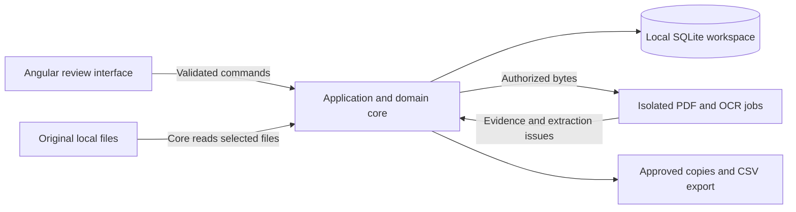

# ReceiptMatch Architecture Evaluation

Status: Phase 2 evaluation and synthetic technical validation accepted by the user on 2026-11-09 within the documented limits. The architecture recommendation remains approved. The user subsequently approved product subphase 3.1 and Jira tracking as REC-2; later subphases and merge requests remain separately gated. The result file was separately authorized.

Basis: [PRD](../requirements/PRD.md), [User Stories](../requirements/USER-STORIES.md), [Open Questions](../requirements/OPEN-QUESTIONS.md), and [MVP Roadmap](../planning/MVP-ROADMAP.md). Evaluation uses ReceiptMatch's own requirements and primary technical documentation; no competing reconciliation application is used as a template.

## Approved validation baseline and alternatives

The approved validation baseline is Electron with an Angular/TypeScript UI, one authoritative TypeScript application/domain core, SQLite through `better-sqlite3`, PDF.js, Tesseract.js, and `csv-stringify`. Production readiness remains conditional on evidence from the validation gates below. The user specified English OCR and Ubuntu; Ubuntu 24.04 x64 is the concrete Linux test environment, not a promise covering every Ubuntu release.

| Concern | Electron | Tauri |
| --- | --- | --- |
| Angular and domain integration | Static Angular frontend with a TypeScript host/core; one implementation of matching and approval rules. | Static Angular frontend with normally Rust-owned privileged commands; additional language/toolchain boundary. |
| Rendering | Bundles Chromium, reducing browser-engine variation. | Uses Windows WebView2 and Linux WebKitGTK; both require rendering/WASM validation. |
| Distribution | Browser/runtime included; native SQLite binding must match Electron and each target. | Smaller shell potential; WebView provisioning, OCR assets, and any sidecars affect actual size. |
| Security boundary | Sandboxed renderer, context isolation, and narrow validated IPC. | Restricted capabilities/custom commands and narrow validated Rust commands. |
| Maintenance trade-off | More bundled runtime to update, but follows the TypeScript preference without a second domain language. | Rust is viable, but the extra integration cost needs an accepted benefit. |

Runtime facts: [Electron process model](https://www.electronjs.org/docs/latest/tutorial/process-model), [Tauri frontend integration](https://v2.tauri.app/start/frontend/), [Tauri WebView versions](https://v2.tauri.app/reference/webview-versions/). The Electron preference is an architectural inference from the TypeScript preference and maintenance costs, not a performance measurement. Reconsider Tauri if an agreed footprint requirement justifies its integration cost and its platform matrix passes; Q-09 currently sets no size/memory target. Do not add a Node sidecar simply to reproduce Electron without a demonstrated benefit.

## Recommended application structure

Prefer one modular desktop application with Angular presentation, an authoritative local application core, SQLite workspace persistence, and isolated PDF/OCR jobs. Keep matching, monetary, approval, and export rules in one authoritative implementation. The runtime comparison must account for maintaining those rules in TypeScript or Rust.



| Boundary | Responsibility |
| --- | --- |
| Presentation | Review, selection, visible uncertainty, batch approval, progress, and summaries; no direct SQL or unrestricted file access. |
| Application core | Import, analyze, match, correct, approve, save, and export commands; authoritative validation and transaction boundaries. |
| Extraction | Prefer embedded text; invoke local OCR when necessary; return source evidence, uncertainty, and failures without invented financial values. |
| Matching | Deterministic rules over normalized input, independent of the UI, database, and filesystem. |
| Persistence | Workspace state, source/account associations, extraction results, suggestions, document associations, and separate approval state. |
| Export | A consistent reconciliation snapshot, approved document copies, a CSV report including outstanding work, and per-output results. |

These are module boundaries, not separate services. A separate localhost HTTP service adds ports, lifecycle, authentication, and packaging without a current requirement. A generic plugin system, event bus, event sourcing, and separate read database are unnecessary for this MVP.

Treat extracted text and document references as untrusted. Use normal Angular bindings and avoid security-bypass rendering. Validate host-command inputs at runtime: TypeScript types are erased and do not validate IPC payloads. Sources: [Angular security](https://angular.dev/best-practices/security), [TypeScript erased types](https://www.typescriptlang.org/docs/handbook/2/basic-types.html#erased-types).

## Desktop privilege and extraction boundaries

For Electron, keep Node integration disabled in renderers, enable context isolation and sandboxing, use a restrictive CSP, validate command senders/payloads, and deny unexpected navigation/popups. Serve application assets locally. Expose use-case commands, not arbitrary SQL, file writes, shell execution, or raw Electron APIs. Source: [Electron security](https://www.electronjs.org/docs/latest/tutorial/security/).

Prefer a dedicated sandboxed extraction renderer, separate from the review UI, receiving authorized document bytes without a general filesystem/SQL bridge. It can use PDF.js/browser canvas and Tesseract.js browser workers; validate bounded results in the core. This proposed combination needs packaged validation under the selected CSP, local protocol, and worker configuration. It avoids making native Node canvas the default dependency.

Do not parse untrusted PDFs in the main process. A Node-enabled `utilityProcess` can contain crashes but still has Node capabilities; it is not equivalent to a restricted parser sandbox. Worker threads likewise do not establish filesystem isolation. Bound jobs, support cancellation, and expose failed pages; concrete limits depend on Q-09. Sources: [Electron sandbox](https://www.electronjs.org/docs/latest/tutorial/sandbox), [utility process](https://www.electronjs.org/docs/latest/api/utility-process).

If Tauri is chosen, scope plugin permissions and explicitly restrict custom commands. Registered application commands are available to all application windows/webviews by default unless restricted; do not assume capabilities alone constrain them. Keep SQL and filesystem operations core-owned. Sources: [Tauri capabilities](https://v2.tauri.app/security/capabilities/), [SQL plugin](https://v2.tauri.app/plugin/sql/).

Render document previews locally without remote navigation or executing embedded document content. Treat display, parsing, and OCR as processing untrusted data, not as a reason to grant access to the rest of the workspace.

## Library evaluation

| Candidate | Recommendation, trade-off, and evidence |
| --- | --- |
| PDF.js / `pdfjs-dist` | Prefer for embedded text, page/position evidence, and rasterization. It supplies PDF primitives, not bank-layout interpretation. Bundle required worker, font/CMap, and WASM assets. Browser-canvas and Node-rendering paths have different packaging costs. [Examples](https://mozilla.github.io/pdf.js/examples/), [Node rendering example](https://github.com/mozilla/pdf.js/blob/master/examples/node/pdf2png/pdf2png.mjs). |
| Tesseract.js | Prefer initially for browser/Node WebAssembly OCR. It does not accept PDFs directly: rasterize required pages first. Explicitly configure local worker/core/language assets and bounded worker reuse. Recognition quality, memory, and throughput need fixture measurements. [PDF limitation](https://github.com/naptha/tesseract.js/blob/master/docs/faq.md), [worker/resource API](https://github.com/naptha/tesseract.js/blob/master/docs/api.md). |
| Native Tesseract | Alternative if measurements justify native integration. Requires platform-specific executable/libraries, image-codec/Leptonica dependencies, language resources, and PDF rasterization. Native execution alone does not prove better recognition. [Upstream dependencies](https://github.com/tesseract-ocr/tesseract). |
| `better-sqlite3` | Prefer for the Electron core, with short transactions and host responsiveness checks. Configure safe-integer/BigInt behavior rather than relying on default JS-number reads; validate amount ranges and IPC conversions. Native binary packaging is a specific cost. [Integer handling](https://github.com/WiseLibs/better-sqlite3/blob/master/docs/integer.md). |
| `rusqlite` | Credible core-owned SQLite alternative if Tauri is selected; do not expose renderer-issued SQL. Exact-value transport and native packaging still need validation. [Upstream](https://github.com/rusqlite/rusqlite). |
| `csv-stringify` | Prefer a maintained serializer over handcrafted CSV quoting. Its formula-escaping option defaults off and can prefix negative numeric strings; agree field-specific text safety and numeric representation first. [Serializer](https://csv.js.org/stringify/), [formula escaping](https://csv.js.org/stringify/options/escape_formulas/). |

These libraries provide documented APIs and upstream sources for standard functionality. Pin exact versions after checking supported toolchains and review maintenance/security status, notices, and the packaged compatibility matrix. The initial documentation-based evaluation did not install dependencies or run upstream tests; actual validation evidence is recorded separately below.

## Local persistence and exact financial values

Recommend SQLite over a custom JSON workspace format. Relational integrity, transactions, and migrations fit reconciliation state; a custom format would transfer these responsibilities into application code. Source: [SQLite as an application file format](https://www.sqlite.org/appfileformat.html).

Use short transactions and one coordinated writer. Do not hold write transactions during OCR or user review. Explicitly enable and verify foreign-key enforcement on every connection. Sources: [SQLite transactions](https://www.sqlite.org/lang_transaction.html), [foreign keys](https://www.sqlite.org/foreignkeys.html).

Canonical monetary values require exact decimal semantics, explicit currency and scale, and range validation. Evaluate scaled integers or a mature exact-decimal library; do not assume every currency has two decimal places. Avoid SQLite `REAL` and JavaScript floating-point arithmetic for canonical financial calculations. Use canonical strings across IPC where necessary to preserve exact values. Sources: [SQLite floating-point accuracy](https://www.sqlite.org/floatingpoint.html), [ECMAScript safe-integer range](https://tc39.es/ecma262/multipage/numbers-and-dates.html#sec-number.max_safe_integer).

Do not select WAL automatically for a single-user workflow. It can improve reader/writer concurrency but introduces checkpointing and sidecar files and is unsuitable for access across hosts on a network filesystem. If live backup becomes required, use supported backup facilities rather than copying only the main database file. Workspace location, backup, encryption, and save/recovery policy remain Q-08/Q-11. Sources: [SQLite WAL](https://www.sqlite.org/wal.html), [backup API](https://www.sqlite.org/backup.html).

## Conceptual data and approval model

This is a conceptual model for review, not a finished schema.

| Record | Minimum responsibility |
| --- | --- |
| Source asset and extraction run | Source identity/fingerprint, page or location, text/OCR method, parser version, extracted candidates, uncertainty, and failures. |
| Account, statement, transaction | Stable individual transaction identity and retained account/statement provenance. |
| Supporting document | Source identity, extracted fields, and supporting evidence. |
| Transaction-document association | A separate relation supporting several documents per transaction now and future document reuse across transactions. |
| Match suggestion | Candidate evidence/conflicts, normalized input revision, rule version, and confidence. |
| User approval | State separate from confidence, linked to the association and data revision reviewed. |

Avoid a document-wide unique constraint that prevents future many-to-many associations. Any agreed temporary restriction on shared documents belongs in application policy. Do not implement allocation amounts, full partial-payment accounting, or dedicated partial-payment UI in the MVP (DEC-05).

Confidence describes the strength of evidence; approval records the user's decision. High confidence never grants approval. Manual associations also need explicit approval semantics. A batch operation must refer to the reviewed selection and validate current revisions. The effects of edits and reanalysis on existing approvals remain Q-05/Q-06; this proposal must not silently settle that policy or reuse approval for changed evidence.

## Extraction and deterministic matching

Use a shared text/OCR extraction pipeline with separate interpretation rules for bank statement layouts and supporting documents. Preserve page/location evidence so users can inspect how fields and individual transaction rows were obtained. PDF text extraction and OCR do not by themselves identify bank transactions or prove financial correctness.

Begin with representative text/scanned PDF layouts and expected outcomes, not universal parsing. Missing, conflicting, or uncertain values remain visible. English is the initial OCR language; concrete layouts, supporting-document formats, and acceptance examples remain Q-01/Q-02.

Generate candidates using approved monetary, currency, date, reference, and merchant evidence. Keep explicit conflicts and stable ordering, and record normalized-input and matching-rule versions for repeatability. Rule weights, date/amount tolerances, classification thresholds, and currency treatment remain Q-04/Q-05; no values are selected here.

## Safe export contracts

Both outputs should derive from one consistent reconciliation snapshot:

- Renamed supporting-document copies use approved associations only and transaction-derived filenames.
- CSV represents transaction/document references, reconciliation statuses, and relevant matching information, including unmatched/unresolved work.
- Destination resolution must protect originals, reject path traversal, and account for source/destination aliases. Names, directory structure, collisions, and repeated-export behavior remain Q-07.
- A database transaction does not make multiple filesystem outputs atomic. Report partial outcomes; do not promise all-or-nothing directory export.
- Use a maintained CSV serializer. Ordinary CSV quoting does not prevent spreadsheet formula injection in untrusted text. Agree consumer-specific handling without silently changing canonical financial values; spreadsheet safety and machine-import fidelity need explicit treatment in Q-07. Source: [OWASP CSV injection](https://community.owasp.org/attacks/CSV_Injection).

## Windows/Linux packaging and licenses

| Target | Packaging implications and unresolved scope |
| --- | --- |
| Windows / Electron | Validate native SQLite target/runtime compatibility and ASAR handling; use bundled Node-API prebuilds when supported and rebuild only when the selected binding/target requires it. Include PDF/OCR resources and validate installer, source permissions, and signing on a clean target. |
| Windows / Tauri | WebView2 must be present. Default provisioning can require a download; an offline/fixed-runtime option is needed if clean offline installation is required. That distribution requirement differs from required offline operation after setup and remains Q-09. |
| Linux / Electron | Agree distribution/architecture/package targets, validate system dependencies and Chromium sandbox operation on clean machines; do not disable the sandbox to resolve packaging failures. |
| Linux / Tauri | Agree a compatible WebKitGTK/system-library baseline and build against intended supported targets. AppImage is not a universal compatibility guarantee. |
| Both runtimes | Include required workers, WASM, traineddata, and PDF assets. Test first launch with an empty cache and denied network access. Native OCR, if chosen, must be an app-managed packaged resource, not an assumed system installation. |

Sources: [Electron native modules](https://www.electronjs.org/docs/latest/tutorial/using-native-node-modules), [`better-sqlite3` packaging troubleshooting](https://github.com/WiseLibs/better-sqlite3/blob/master/docs/troubleshooting.md), [Tauri Windows installers](https://v2.tauri.app/distribute/windows-installer/), [Tauri Linux packaging](https://v2.tauri.app/distribute/appimage/). Automatic updates and telemetry are not added MVP requirements. Q-09 must settle target platforms, distribution, and signing expectations.

ReceiptMatch is MIT-licensed. Reviewed upstream top-level licenses are [Electron MIT](https://github.com/electron/electron/blob/main/LICENSE), [Tauri MIT/Apache-2.0](https://github.com/tauri-apps/tauri), [PDF.js Apache-2.0](https://github.com/mozilla/pdf.js/blob/master/LICENSE), [Tesseract.js Apache-2.0](https://github.com/naptha/tesseract.js/blob/master/LICENSE.md), [`better-sqlite3` MIT](https://github.com/WiseLibs/better-sqlite3/blob/master/LICENSE), and [`csv-stringify` MIT](https://github.com/adaltas/node-csv/blob/master/LICENSE). These are candidates subject to preserving applicable license/notice obligations. Review the exact bundled binaries, native transitives, fonts, WASM, and language datasets before release; top-level labels alone do not complete artifact-level license compatibility or security review.

## Proposed verification and remaining gates

The user approved the following technical experiments. This table defines intended evidence; it does not state that each check has passed.

| Requirement coverage | Required evidence before implementation acceptance |
| --- | --- |
| FR-01–FR-04 | Representative text/scanned PDFs, expected individual transactions and fields, source/account provenance, required local OCR, visible failures/uncertainty, and no silently omitted transaction rows. |
| FR-05–FR-08, FR-12 | Repeatable suggestions, competing candidates, manual groups, independent confidence/approval, and batch operations against reviewed revisions. |
| FR-09 | Exact-amount round trips, save/reopen, integrity constraints, migrations, and failure recovery under the approved save policy. |
| FR-10, FR-13 | Unapproved-copy rejection; CSV coverage of outstanding work; path/alias/collision cases; safe textual CSV fields; and reported partial failures. |
| FR-11 | Summary consistency with persisted associations, approvals, and the agreed meaning of manual processing. |
| NFR-01–NFR-06 | Original hashes unchanged on success/failure; offline operation with bundled resources; Windows/Linux delivery; and dependency/license review. |

Extraction quality, packaging feasibility, responsiveness, and platform parity are not demonstrated by documentation review alone. Fixture measurements are diagnostic evidence, not approved product budgets. Q-09/Q-12 must define workloads and success evidence before product performance claims.

Approved validation order: package the Angular shell and SQLite binding on Windows and Ubuntu; verify empty-cache offline English PDF/OCR; exercise malformed/mixed-page documents, cancellation, and worker failure; round-trip exact data and approval revisions; verify export safety and CSV consumer behavior; then record fixture performance and distribution size. Synthetic fixtures and policies are test assumptions, not answers to the remaining product questions.

For later E2E tooling, [Playwright Electron automation](https://playwright.dev/docs/api/class-electron) is documented as experimental; confirm support in the selected release. [Tauri WebDriver testing](https://v2.tauri.app/develop/tests/webdriver/) is an alternative if Tauri is selected. Browser-only tests cannot demonstrate native packaging, IPC, or filesystem safety.

## Product dependencies and approval boundary

| Remaining decision | Effect on the recommendation |
| --- | --- |
| Q-01/Q-02: layouts, sample outcomes, document formats, representative English OCR examples | Determines extraction coverage, resources, and validation evidence; no universal PDF support is promised. |
| Q-03/Q-04: groups, currencies, date/amount semantics and tolerances | Determines association and matching policy, without introducing deferred full partial-payment UI. |
| Q-05/Q-06: classifications, manual processing, batch selection, edits/reanalysis, duplicates | Determines approval transitions and summary rules; confidence remains independent of approval. |
| Q-07: names, CSV fields/consumers, collisions, export structure and failure behavior | Determines safe, usable exports; source protection and approved-only document copies remain mandatory. |
| Q-08/Q-11: source ownership/location, recursion, save/recovery, encryption and diagnostics | Determines workspace lifecycle, privacy, and persistence details; local storage alone is not an encryption guarantee. |
| Q-09/Q-12: platforms, workloads, distribution and success evidence | Determines packaging gates and measurable budgets; no unmeasured performance promise is made. |
| Q-10: field editing, initial language and locale | Determines review behavior and correction/localization scope. |

The architecture recommendation and technical validation are accepted. Validation code remains isolated under `validation/architecture`. Product subphase 3.1 is subsequently authorized as REC-2; DEC-06 through DEC-11 record the approved starting rules. Remaining product questions must be resolved before their affected later subphases. Additional documentation files, merge requests, merges, and deployment require their applicable explicit authorization.

## Executed technical validation — 2026-11-09

The isolated [validation package](../../validation/architecture/package.json) builds Angular AOT, bundles the host/extraction code and local resources, packages Electron into ASAR, and launches the packaged executable in two separate save/restore processes. Only synthetic text, scanned, mixed-page, and malformed PDFs are generated; no real financial documents are accessed.

Pinned versions: Electron 45.2.3; Angular framework 22.2.5 and build/CLI 22.2.6; TypeScript 6.0.2; `better-sqlite3` 13.0.3; PDF.js 6.5.438; Tesseract.js 7.0.0 with English data package 1.0.0; `csv-stringify` 6.6.0. `pdf-lib` 1.17.1 generates fixtures. Tooling uses Node 24.15.0 on Windows and 24.21.0 in Ubuntu; packaged Electron embeds Node 24.22.2 on both.

| Evidence | Windows x64 | Ubuntu 24.04 x64 |
| --- | --- | --- |
| Environment | Host OS build 10.0.26300; hidden packaged windows | Docker Desktop Linux container, Xvfb, non-root user |
| Packaged checks | 26 passed across save/restore | 26 passed across save/restore |
| Runner error-report checks | Four negative scenarios passed | Four negative scenarios passed |
| Offline controls | Fresh per-process profile; Electron session denies external requests; zero attempts recorded | Same controls plus Docker `--network none`; zero attempts recorded |
| Application startup, save/restore | 498 / 219 ms | 142 / 142 ms |
| Synthetic extraction trio, four pages including two OCR pages | 2,427 ms | 2,254 ms |
| Package directory size | 485,657,330 bytes (463.2 MiB) | 398,798,590 bytes (380.3 MiB) |

Timings are single observed fixture runs, including setup/IPC overhead, not product budgets, cold-system measurements, or batch throughput benchmarks. Packages are unoptimized validation directories, not installer sizes. Per-process working-set snapshots are recorded in JSON after each stage; they are not peak OCR memory measurements and shared memory must not be treated as uniquely owned by summing them.

Machine evidence, generated under ignored `artifacts/`:

- [Windows result](../../validation/architecture/artifacts/results-win32.json), run `32716f3e-5436-4766-b5e4-9651d6d32bfb`.
- [Ubuntu result](../../validation/architecture/artifacts/results-linux.json), run `94faf798-9576-41d8-a1ec-e8fde0d581ac`.
- [Windows runner verification](../../validation/architecture/artifacts/runner-verification.json) and [Ubuntu runner verification](../../validation/architecture/artifacts/runner-verification-linux.json).

### What passed

- Angular AOT loads inside the packaged app; review and extraction renderers have Node disabled, context isolation, and sandbox configuration. Extraction uses a separate renderer while the Angular heartbeat continues.
- Embedded PDF text is preferred; image-only/mixed pages use local English OCR with bundled workers/WASM/traineddata and disabled OCR cache. Malformed PDFs, missing resources, fixture page/pixel limits, and invalid/oversized extraction results fail visibly.
- Cancellation is tested at the OCR boundary. A separately forced extraction-renderer crash is detected while the review UI survives. This is not a test of cancellation during active recognition.
- SQLite loads the pinned release's bundled Node-API prebuild without MSVC or an Electron rebuild. Exact signed integer coefficients beyond the JS safe-integer range, explicit currency/scale, associations, and independent confidence/approval survive a genuine process restart and actual core/renderer IPC. Group/shared-document fixtures demonstrate storage readiness, not a partial-payment workflow.
- Fixture approval revisions prevent unapproved/stale document copies. Batch failure rolls back atomically. Portable filename checks, traversal rejection, directory aliases/junctions, existing files, partial export outcomes, and original hashes are verified.
- The six-row fixture CSV comes from persisted association joins after batch approval, including multiple documents, stale and unmatched/unresolved work. References, confidence, approval, and the full serialized output are checked. Text formula escaping does not alter validated exact integer coefficient strings.
- Runner launch error, timeout, missing stage report, and failed stage report each replace old success with a current failed report identified by run ID/timestamps.

### Integration findings and review

The pinned SQLite release uses Node-API prebuilds; an unconditional Electron rebuild was unnecessary and its tooling was removed. PDF.js 6 cleanup must use the loading task rather than assuming the document proxy exposes `destroy()`.

The initial dependency audit found five moderate transitive build-tool findings. Targeted `@electron/asar` overrides to `glob` 14.0.4 and `minimatch` 11.0.5 preserved the used APIs; packaging passed on both targets and the final dependency audit reported zero known vulnerabilities. This is not a complete artifact-level security/license audit.

Software Architect independently identified inconsistent hardcoded CSV projection and stale success reports on failure. Both were corrected, regression-checked, and independently verified before the final results above. There are no remaining findings from that focused review.

### Reproduction and limits

From `validation/architecture` on Windows: `npm ci`, `npm run build`, `npm run package`, `npm run validate:runner`, then `npm run validate:packaged`. Generated build/package/result directories are ignored; the [lockfile](../../validation/architecture/package-lock.json) is retained.

From the repository root for Ubuntu:

```sh
docker build -t receiptmatch-architecture-validation:ubuntu24.04 -f validation/architecture/Dockerfile validation/architecture
docker run --init --network none --cap-add SYS_ADMIN --shm-size=512m --name receiptmatch-validation-ubuntu receiptmatch-architecture-validation:ubuntu24.04 xvfb-run -a sh -c 'npm run validate:runner && npm run validate:packaged'
docker cp receiptmatch-validation-ubuntu:/work/artifacts/results-linux.json validation/architecture/artifacts/results-linux.json
docker cp receiptmatch-validation-ubuntu:/work/artifacts/runner-verification.json validation/architecture/artifacts/runner-verification-linux.json
```

Use an unused container name for repeat runs. This Docker host required `SYS_ADMIN` for user namespaces and `--init` for reliable Xvfb process handling; no `--no-sandbox` flag was used. The container lacks a desktop D-Bus session and emits related diagnostics; invalid-IPC, malformed-PDF, and forced-crash output also belongs to the deliberate negative tests. This is not a clean Ubuntu desktop installation test.

Remaining limits: no real bank-layout/transaction parser, financial field-normalization accuracy, production matching algorithm, final summary/status policy, product CSV contract, Excel/LibreOffice consumer behavior, installer/signing, release notice audit, peak-memory benchmark, sustained workload, or broader Windows/Ubuntu release matrix was validated. Matching suggestions and revision/CSV policies are explicitly fixtures, not answers to Q-01 through Q-12. Exact serialized coefficients do not prove spreadsheet import preserves numeric precision. Windows session-level network interception is not an OS-wide egress/firewall test.

## Product foundation — REC-2 / subphase 3.1

Status: implemented and verified, pending user acceptance. Ticket [REC-2](https://wigtertainment.atlassian.net/browse/REC-2) is under [REC-1](https://wigtertainment.atlassian.net/browse/REC-1); branch `EK/REC-2-local-desktop-workspace` starts from `main`. No merge request, merge, or subsequent subphase is authorized.

The separate production application provides an English workspace UI, native New/Open/Save actions, editable names, explicit SQLite persistence, and Save/Discard/Cancel protection before leaving unsaved work. Failed/cancelled operations retain current state. The renderer has no arbitrary SQL/filesystem API. Relational storage preserves exact coefficient strings, currency/scale, source references, many-to-many-ready associations, and independent confidence/approval. Financial records are not seeded in the product.

| Verification | Windows x64 | Ubuntu 24.04 x64 |
| --- | --- | --- |
| Strict host/shared TypeScript and Angular AOT | Passed | Passed |
| Persistence/controller integration | Nine passed | Nine passed |
| Actual packaged UI checks | Nine passed | Nine passed without container network access |
| Result | [Windows report](../../artifacts/workspace-ui-win32.json), run `0eb907b7-00c0-4f36-a048-63c81c6e2778` | [Ubuntu report](../../artifacts/workspace-ui-linux.json), run `03f4dfc1-cacc-4770-addf-5d18c1d24233` |

Coverage includes real multi-character typing/focus, save/open cancellation, unsaved Save/Discard/Cancel, existing-file collisions, read-only rejection of foreign/corrupt/future databases, failed-save retry, close/restart, exact seeded-state preservation, and competing SQLite writers. Dependency installation audit reported zero known vulnerabilities.

`npm run check` now enforces ESLint with zero warnings across application and validation sources and checks HTML formatting with Prettier. Generated outputs are excluded; inline Angular templates retain accessibility checks. The lint toolchain pins transitive `minimatch` to 11.0.5 for [GHSA-g3hv-75wg-m249](https://github.com/advisories/GHSA-g3hv-75wg-m249); its used matching APIs and configuration enforcement were verified.

Independent review identified a post-commit fingerprint race. Metadata and fingerprint are now captured from a protected committed revision; hashing descriptors are opened before SQLite and closed after it, avoiding POSIX lock loss from an unrelated descriptor close. Create/save regression probes use a separate Node process and require `SQLITE_BUSY` during capture. The reviewer verified the correction. Sources: [SQLite locking mode](https://www.sqlite.org/pragma.html#pragma_locking_mode), [POSIX descriptor caveat](https://www.sqlite.org/howtocorrupt.html#_posix_advisory_locks_canceled_by_a_separate_thread_doing_close_).

ASAR inspection confirms application source directories (`src/`, `electron/`), tests, the validation harness, project documentation, and AGENTS are excluded; compiled runtime code and dependencies remain. The strict CSP remains intact; Angular inline-critical CSS was disabled rather than weakening it. Secondary text was adjusted to a measured 5.04:1 contrast on the canvas.

Hidden-window screenshots were unreliable and remain explicit diagnostics in the reports; they do not count as successful visual checks. A separate visible-window capture within the isolated Ubuntu virtual display produced the actual [welcome](../../artifacts/rec2-welcome.png) and [saved workspace](../../artifacts/rec2-workspace.png), both visually checked. Capture bounds use the measured content viewport to avoid extra compositor rows.

Limits: native dialog choices are stubbed only through automation, with no production test bypass. E2E uses test-only software-rendering flags; physical GPU/native-dialog appearance, installers/signing, broader OS versions, and network filesystems are not certified. Product PDF import, OCR, matching, review actions, and exports remain later work. Build/run and repeatable checks are in the existing [README](../../README.md).
